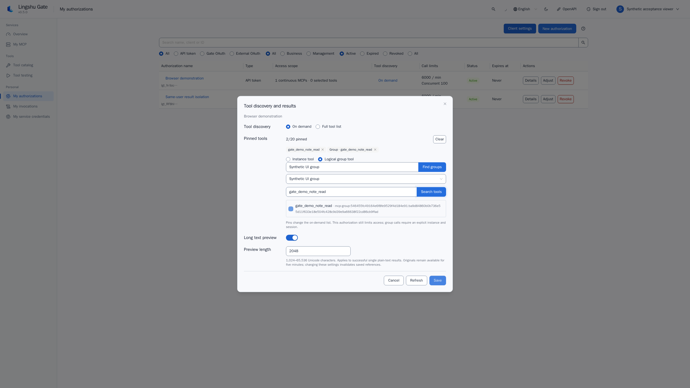
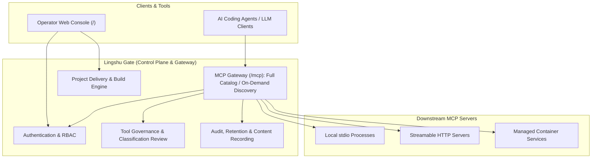

# Lingshu Gate

A self-hosted MCP gateway that connects tools, limits who can call them, and records what happened.

[简体中文](README.zh-CN.md) · [Download 0.5.2](https://github.com/zhigege666/Lingshu-Gate/releases/tag/v0.5.2) · [Get started](docs/getting-started.md) · [Documentation](docs/README.md) · [Security](SECURITY.md)



*0.5.0 Console, captured at 2560×1440 with synthetic users and services. [Capture record](docs/images/console/v0.5.0-capture.json).*

## Where Gate fits

- **One controlled tool entry:** connect multiple MCP services, review and publish tools, then give each user or authorization a limited view through one `/mcp` endpoint.
- **Connect existing services:** reach private HTTP MCPs through an explicitly configured connector, or expose selected operations from a local OpenAPI snapshot. Use native Gate for trusted local stdio and project delivery.
- **Operate with evidence:** inspect invocation decisions, constrain effective tool arguments and opt into Prometheus metrics or OTLP traces.

## Quick start

| Goal | Choose | Start here |
|---|---|---|
| Try a released version | Native archive, or the released-image Docker trial | [Download and start](docs/getting-started.md) |
| Deploy for production | Digest-pinned Core behind HTTPS, or a managed native service | [Deployment, backup and upgrades](docs/deployment.md) |
| Develop Gate | Source checkout and locked dependencies | [Local development](docs/local-development.md) |

### Prebuilt native package

Download the matching OS/CPU archive and `SHA256SUMS`, [verify it](docs/releases.md#verify-a-download), extract it and enter its directory. Run `./start.sh` on Linux/macOS or `.\start.cmd` on Windows. Gate itself needs no host Python, Node.js or Git.

Open [http://127.0.0.1:8000/](http://127.0.0.1:8000/). Read `data/initial-admin-credentials.json` locally, sign in, change the password and sign in again. The generated initial file is removed and the old session is revoked. The package's own English/Chinese README includes the full platform-specific path.

### Released Docker trial

Verify and extract `lingshu-gate-v0.5.4-docker-compose.tar.gz`, enter that directory and run:

```bash
cp .env.quickstart.example .env.quickstart
docker compose --env-file .env.quickstart -f compose.quickstart.yaml up -d --no-build --wait --wait-timeout 120 core
docker compose --env-file .env.quickstart -f compose.quickstart.yaml exec core cat /data/initial-admin-credentials.json
```

Open [http://127.0.0.1:8000/](http://127.0.0.1:8000/), sign in with those local one-time credentials and change the password. This uses the released image, loopback-only HTTP, authentication, separate trial volumes, UID/GID `10001`, a read-only root and no engine socket. PowerShell can use `Copy-Item` for the first line. See [getting started](docs/getting-started.md) for ports and offline images.

### Production deployment

Use the bundle's default `compose.yaml` and paired `DEPLOYMENT.md` / `DEPLOYMENT.zh-CN.md`: select a published digest, prepare readable protected bootstrap credentials, persistent storage and HTTPS with Secure cookies. Follow [deployment](docs/deployment.md) for exact proxy, origin, backup and upgrade requirements. Keep one Core per database.

### From source

Requirements: Git, Python 3.11–3.13, uv, Node.js 22.12+ in 22.x, 24.x or 26+, and npm.

```bash
git clone https://github.com/zhigege666/Lingshu-Gate.git
cd Lingshu-Gate
uv sync --frozen
npm --prefix web ci
npm --prefix web run build
uv run lingshu-gate
```

For a source Docker build, run `mkdir -p runtime/workspace` and `docker compose up -d --build --wait --wait-timeout 120 core` from that repository root. [Local development](docs/local-development.md) explains separate paths, credentials and test commands.

## First authorized call

The [included demo walkthrough](docs/first-call.md) needs no external service account or desktop MCP client. Start the independent in-memory demo, connect it in Gate, review and publish three tools, then create a separate read-only caller. Follow `tools/list → gate_catalog_search → gate_tool_describe → gate_tool_invoke` using the returned tool reference and revision.

Check the successful audit, deny a write with an unchanged counter, reject an invalid revision, stop/restart the demo and revoke the caller. Gate startup, tool discovery, classification confirmation and publication are separate steps; access still requires both resource grants and token scope.

## 0.5.4 release

This release requires certifi 2026.10.19 or later to address GHSA-6q48-6c7w-9gw2 and retains configurable downstream MCP message budgets, defaulting to 32 MiB for stdio, HTTP JSON and SSE while retaining oversized-message protection, deadlines and paging limits. Restart Gate after changing `LINGSHU_GATE_MCP_MAX_MESSAGE_BYTES`. There are no new migrations over 0.5.3; the existing certifi dependency is upgraded; older upgrades still require a consistent database, configuration and credential-key backup. The following features and boundaries continue from 0.5.2. See [changes](CHANGELOG.md) and the [bilingual release notes](packaging/release-notes.md).

This release adds personal and shared business accounts to the existing credentials pages, with environment and business-role labels, explicit user/role grants, MCP instance bindings and synchronization status for each target. The first adapter connects a dedicated agent-browser vault: agents use a `gate:<credential-id>` reference and an explicit session. It also fixes long MCP names and status badges in tool review, and removes deleted MCP tools from the current governance catalog while retaining audit history. See [changes](CHANGELOG.md) and the [bilingual release notes](packaging/release-notes.md).

Business-account bindings require existing MCP permissions. The first binding applies managed-browser restrictions to all calls through that instance; removing the final binding does not restore raw vault access. Use a dedicated trusted instance and review its actual tool contract. A login-action receipt does not prove successful website authentication; installed downstream compatibility and real account logins still require separate acceptance. See [business credentials](docs/business-credentials.md).

Upgrade applies migration `0024_business_credentials`. Back up the database, configuration and all credential keys together, including `<data-dir>/business-credentials/credential.key` once business credentials are used. The remote browser vault has its own key and lifecycle. Desktop validation covers 2560×1440, 1920×1080, 1600×900 and 2560×1080; this release adds no mobile support.

## Architecture overview



## Features


| Feature | Capability and boundary | Guide |
|---|---|---|
| MCP gateway and transports | One authenticated Model Context Protocol endpoint; stateless JSON `/mcp`, remote MCP over Streamable HTTP, native stdio, explicit versions and bounded legacy negotiation. Tool aggregation, not generic resource/prompt hosting. | [Guide](docs/mcp-gateway.md) |
| MCP groups and instance sessions | Logical groups reference existing instances without copying credentials or granting access; contract partitions and connection-bound sessions. | [Guide](docs/mcp-groups.md) |
| On-demand tool discovery | Six default entries, up to 20 authorized fixed tools/groups, and optional bounded text-result paging; each authorization retains its own scope. | [Guide](docs/on-demand-tools.md) |
| Argument policies | Exact equality, allowed values, numeric ranges and string prefixes on effective arguments; pure preview and revisioned audited saves. | [Guide](docs/argument-policies.md) |
| Private HTTP MCP connector | Fixed-target relay/agent with distinct credentials, bounded sessions and no automatic business replay. | [Guide](docs/private-connector.md) |
| OpenAPI adapter | Explicit operations from local OpenAPI 3.0/3.1 snapshots, fixed origins and contract-bound tool names. | [Guide](docs/openapi-adapter.md) |
| Standard telemetry | Default-off Prometheus aggregates and OTLP/HTTP tracing, protected control-plane endpoints and bounded export. | [Guide](docs/telemetry.md) |
| Accounts and RBAC | Local sign-in, registration review, custom roles and permission types, service/tool grants, expiry, scoped personal API tokens and user status controls. | [Guide](docs/configuration.md) |
| Tool governance | Discovery → rule analysis → human review → publication; read/write and destructive/idempotent classifications, fingerprint checks, batch review and stale-definition reconciliation. Discovery never grants access. | [Guide](docs/mcp-gateway.md) |
| Built-in OAuth and remote access | Opt-in authorization-code flow for OAuth 2.1 / PKCE clients: confidential static clients, S256, per-user tool consent, encrypted RS256 signing keys, refresh rotation and revocation. Independent public consent UI; no DCR/CIMD or full-conformance claim. | [Guide](docs/builtin-oauth.md) |
| External identity providers | Optional external RS256 JWT verification, exact issuer/JWKS/audience/resource/client bindings, subject links and owner-bound delegations. Direct HTTPS or operator-managed tunnel configuration; Gate does not create tunnels. | [Guide](docs/external-connections.md) |
| Service configuration and lifecycle | Manifest Form/JSON editing, static validation, apply/reload, start/stop/connect, sectioned details, health, logs and restart history. Native managed containers require an explicitly approved digest-pinned image. | [Guide](docs/configuration.md) |
| Tool catalog and debugging | Service-scoped catalog and effective access badges; schema-driven Form/JSON arguments, defaults/examples, persistent result review and local result-content search. Invocation still rechecks permissions. | [Guide](docs/operations.md) |
| Encrypted credentials | Shared credential references and private per-user HTTP downstream bindings, masked metadata and one-time token/secret display. Shared stdio processes do not receive per-user credentials. | [Guide](docs/configuration.md) |
| Business accounts and browser bindings | Encrypted personal/shared website accounts, explicit users/roles and MCP targets, versioned vault synchronization and isolated logical sessions. The first adapter requires a dedicated, trusted agent-browser instance; bindings do not grant MCP access. | [Guide](docs/business-credentials.md) |
| Trusted project delivery | ZIP analysis and resumable MCP uploads, preflight, digest-bound BuildPlan, bounded build logs/cancellation, deployment preview and overwrite protection, startup and tool reconciliation. Native execution trusts project code; it is not an untrusted-code sandbox. | [Guide](docs/project-delivery.md) |
| Private drafts and recovery | Encrypted revisioned delivery drafts, independent upload/build/deploy/start confirmations, idempotent MCP writes and protected manual rollback. Replacement can interrupt a service; sessions do not migrate seamlessly. | [Guide](docs/console-delivery.md) |
| Git, proxies and dependency sources — partial | HTTPS commit-pinned plans, source bounds, named encrypted proxy revisions, separate Git/install defaults, inherit/direct/profile overrides and independent npm/Python sources. npm/pnpm/Yarn Classic plan checks are implemented. Optional Native/Linux acquisition/probes/fixed tool preparation and registry-only npm, pnpm 8/9 and Yarn Classic offline installs/builds are implemented but real host acceptance is untested. Other manager cache installs are explicitly blocked. | [Guide](docs/git-import-network.md) |
| Personal workspace and file references | My MCP, connections, grants, invocations, API tokens and downstream credentials; short-lived user/target-bound `fileRef` uploads only for tools that explicitly accept them. | [Guide](docs/mcp-gateway.md) |
| Audit and observability | Tool audit decisions, invocation statistics, authorized service/tool log scopes, events, diagnostics, memory/environment summaries, runtime cache and liveness/startup/readiness probes. | [Guide](docs/operations.md) |
| Content recording and retention | Opt-in redacted bounded invocation input/output recording; separate log/event/invocation policies, cleanup preview and tracked jobs. Seven days is a default policy; the scheduled retention worker is off by default. | [Guide](docs/retention.md) |
| Console, API, automation and packages | English/Chinese, light/dark themes, desktop layouts, filtering/pagination, private REST/OpenAPI and CLI; confirmation-bound `gate_*` tools and Delivery Skill. Native packages, Docker Core, offline images, checksums, SBOM and backup/upgrade workflows. | [Guide](docs/releases.md) |

See the documentation index below for all workflows. [Invocation content recording](docs/invocation-recording.md) · [Git executor decision](docs/git-executor-decision.md)

## Project delivery and remote access

Upload, preflight, build, deploy, overwrite, start, cancel and abandon keep their own permissions and confirmations; MCP writes also bind idempotency keys and digests. The Console saves encrypted private drafts, previews deployment differences and supports explicitly requested manual rollback when a protected snapshot is available. See [Project delivery](docs/project-delivery.md), [Console delivery](docs/console-delivery.md) and the bundled [Delivery Skill](.agents/skills/lingshu-gate-upload-build-start/SKILL.md).

Remote access can use Gate API tokens, built-in OAuth or an external RS256 IdP; OAuth defaults to disabled. Built-in mode reuses Gate users with separate public sign-in and tool consent; external mode verifies provider-issued tokens. `direct` HTTPS and `secure_mcp_tunnel` are operator-managed network choices. A reverse proxy cannot cross NAT alone, and a machine tunnel key is not a user identity. See [Built-in OAuth](docs/builtin-oauth.md) and [external identity/network access](docs/external-connections.md). Keep Console and `/v1` private; expose only the selected mode's MCP, discovery and required `/oauth` paths.

## Security defaults

- Authentication is enabled, and initial credentials are random and local to the data directory.
- Network binding defaults to loopback; remote access belongs behind an HTTPS reverse proxy.
- Session cookies are `HttpOnly` and `SameSite=Lax`; enable `LINGSHU_GATE_AUTH_COOKIE_SECURE=true` behind HTTPS.
- MCP payload logging is disabled by default.
- Core-managed credentials are encrypted at rest and returned as masked metadata; connector and adapter credentials use separate protected local files. Manifests should use `${credential:<id>}` references.
- Tool annotations are hints. Human-reviewed, published classifications and explicit grants determine effective access.
- The Docker Core service drops Linux capabilities, prevents privilege escalation, and mounts the workspace read-only.

Read [SECURITY.md](SECURITY.md) before exposing Gate outside a single trusted host.

## Release downloads

Release automation builds the following archives:

| Target | Archive |
|---|---|
| Linux x86-64 | `lingshu-gate-v<version>-linux-x86_64.tar.gz` |
| Linux ARM64 | `lingshu-gate-v<version>-linux-aarch64.tar.gz` |
| Windows x86-64 | `lingshu-gate-v<version>-windows-x86_64.zip` |
| macOS x86-64 | `lingshu-gate-v<version>-macos-x86_64.tar.gz` |
| macOS ARM64 | `lingshu-gate-v<version>-macos-arm64.tar.gz` |
| Docker Compose | `lingshu-gate-v<version>-docker-compose.tar.gz` |

Tagged releases also provide offline Linux Core images for `amd64` and `arm64` plus an application SPDX SBOM. Every native archive contains `SBOM.spdx.json`, `BUILD-INFO.json`, `LICENSE`, `NOTICE`, `THIRD_PARTY_NOTICES.md`, and package-specific English/Chinese start pages. Verify the selected archive against `SHA256SUMS` before extraction; see [Release artifacts](docs/releases.md).

Native and Compose bundles also include paired guides, neutral examples, changelogs, security policies, release notes and the Project Delivery Skill. Start with [First authorized call](docs/first-call.md).

## Support matrix

| Capability | Linux native | Windows native | macOS native | Docker Core |
|---|:---:|:---:|:---:|:---:|
| Console, REST API, `/mcp` gateway | Yes | Yes | Yes | Yes |
| External Streamable HTTP downstream | Yes | Yes | Yes | Yes |
| Managed local stdio downstream | Yes | Yes | Yes | No |
| Explicit managed-container downstream | When a local engine is available | When a local engine is available | When a local engine is available | No |
| Local project build execution | With required host toolchain | With required host toolchain | With required host toolchain | No |
| SQLite persistence | Yes | Yes | Yes | Yes, single Core replica |
| Release architecture | x86-64, ARM64 | x86-64 | x86-64, ARM64 | Linux amd64, arm64 |

Native archives bundle Gate, not every project runtime. Downstream launch and build portability still depends on the project's own toolchain, commands, paths, and dependencies; preflight reports missing requirements before execution.

## Support boundaries

- Inbound `/mcp` is stateless JSON. It does not expose GET/SSE, separate legacy HTTP+SSE, general resources/prompts or unsolicited server messages. Downstream POST SSE responses do not expand inbound support.
- SQLite and quotas have a single-Core/single-process boundary, with no multi-tenancy or distributed quota guarantee. Core cannot execute local build/deploy/start and has no engine socket. Native trusted-project execution is not code isolation.
- Git SSH, automatic hooks/submodules/LFS and redirect credential forwarding are unsupported. Delivery proxies do not flow into runtime MCP or alter global Git/npm settings. Exact manager startup requires an administrator-reviewed Node/CLI registry; tools are not installed automatically.
- Automated checks use synthetic isolated environments. Real ChatGPT/OAuth, user Git/proxy and production upgrade acceptance remain separate. Platform packages and images are available only when the tagged release workflow actually publishes them.

## Documentation

- [Getting started: native, Docker, production and source](docs/getting-started.md)
- [First successful and denied calls](docs/first-call.md)
- [Tool argument policies](docs/argument-policies.md)
- [Private HTTP MCP connector](docs/private-connector.md)
- [Selected OpenAPI operations](docs/openapi-adapter.md)
- [Prometheus metrics and OTLP traces](docs/telemetry.md)

- [MCP gateway, protocols, tool grants and file references](docs/mcp-gateway.md)
- [MCP groups and routing contracts](docs/mcp-groups.md)
- [On-demand tools discovery](docs/on-demand-tools.md)
- [Accounts, configuration, credentials and runtime policy](docs/configuration.md)
- [Business accounts and agent-browser bindings](docs/business-credentials.md)
- [Built-in OAuth administration and consent](docs/builtin-oauth.md)
- [External identity and remote network access](docs/external-connections.md)
- [Project delivery API/tools and Delivery Skill](docs/project-delivery.md)
- [Console delivery, private drafts and rollback](docs/console-delivery.md)
- [Git plans, network profiles and dependency sources](docs/git-import-network.md)
- [Git executor implementation and rollout decision](docs/git-executor-decision.md)
- [Native isolated executor](docs/native-executor.md)
- [Service operations, debugging, audit and diagnostics](docs/operations.md)
- [Invocation input/output recording](docs/invocation-recording.md)
- [Retention policy and confirmed cleanup](docs/retention.md)
- [Deployment, backup, upgrades and recovery](docs/deployment.md)
- [Release packages, checksums and SBOM](docs/releases.md)
- [Architecture and security boundaries](docs/architecture.md)
- [Development, API and automated checks](docs/local-development.md)
- [Synthetic browser regression scenarios](docs/browser-regression.md)
- [Bounded performance measurement](docs/performance-review.md)
- [UI and accessibility acceptance contract](docs/ui-interaction-contract.md)
- [0.4.0 validation and screenshot provenance](docs/release-validation.md)
- [0.4.7 release candidate validation](docs/release-validation-0.4.7.md)


## Help improve Gate

If Gate solves a problem for you, star the repository to find it again and use GitHub Watch → Custom → Releases for release notifications. Share a minimal, redacted reproduction when reporting an issue, or contribute a small integration example with its permission and failure cases. The [first-call guide](docs/first-call.md) is a useful starting point for trying the project or showing it to a colleague.

## License

Lingshu Gate is distributed under the Apache License 2.0. See [LICENSE](LICENSE) and [NOTICE](NOTICE). Third-party components remain subject to their respective licenses; packaged notices are recorded in [THIRD_PARTY_NOTICES.md](THIRD_PARTY_NOTICES.md).
