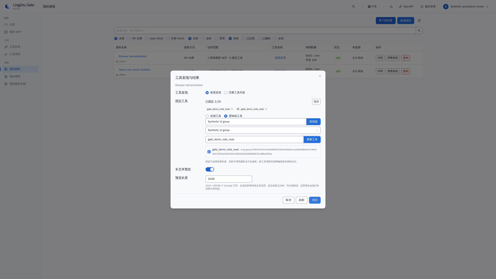
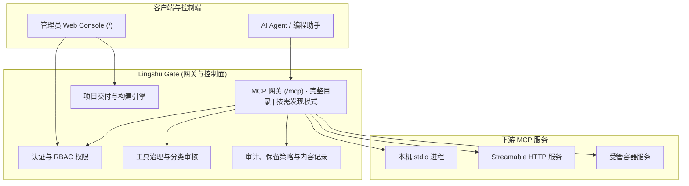

# Lingshu Gate

自托管 MCP 网关：连接工具，限定谁可以调用，并记录调用结果。

[English](README.md) · [下载 0.5.6](https://github.com/zhigege666/Lingshu-Gate/releases/tag/v0.5.6) · [开始使用](docs/zh-CN/getting-started.md) · [文档](docs/zh-CN/README.md) · [安全](SECURITY.zh-CN.md)



*0.5.0 Console，以合成用户和服务在 2560×1440 下实际截图。[捕获记录](docs/images/console/v0.5.0-capture.json)。*

## 适合哪些场景

- **统一受控工具入口：** 接入多个 MCP 服务，审核并发布工具，再通过一个 `/mcp` 入口为不同用户和授权提供限定范围。
- **接入已有服务：** 通过明确配置的连接器访问私网 HTTP MCP，或将本地 OpenAPI 快照中的选定操作转换为工具。可信本地 stdio 和项目交付使用原生 Gate。
- **核对运行结果：** 查看调用决策，限制实际工具参数，并按需接入 Prometheus 指标或 OTLP 链路。

## 快速开始

| 目标 | 选择 | 入口 |
|---|---|---|
| 试用已发布版本 | 原生归档，或使用发行镜像的 Docker 本机试用 | [下载并启动](docs/zh-CN/getting-started.md) |
| 生产部署 | HTTPS 后固定 digest 的 Core，或托管原生服务 | [部署、备份和升级](docs/zh-CN/deployment.md) |
| 开发 Gate | 源码仓库和锁定依赖 | [本地开发](docs/zh-CN/local-development.md) |

### 预编译原生包

下载匹配系统、CPU 的归档及 `SHA256SUMS`，[校验](docs/zh-CN/releases.md)后解压并进入目录。Linux/macOS 运行 `./start.sh`，Windows 运行 `.\start.cmd`。Gate 本身不需要宿主安装 Python、Node.js 或 Git。

打开 [http://127.0.0.1:8000/](http://127.0.0.1:8000/)，在本机读取 `data/initial-admin-credentials.json`，登录、修改密码并重新登录。生成的初始文件会删除，旧会话会撤销。包内中英文 README 提供对应平台的完整步骤。

### 已发布 Docker 本机试用

校验并解压 `lingshu-gate-v0.5.6-docker-compose.tar.gz`，进入该目录后执行：

```bash
cp .env.quickstart.example .env.quickstart
docker compose --env-file .env.quickstart -f compose.quickstart.yaml up -d --no-build --wait --wait-timeout 120 core
docker compose --env-file .env.quickstart -f compose.quickstart.yaml exec core cat /data/initial-admin-credentials.json
```

打开 [http://127.0.0.1:8000/](http://127.0.0.1:8000/)，用本机一次性凭据登录并改密。该方式使用发行镜像、仅限 loopback 的 HTTP、认证、独立试用卷、UID/GID `10001`、只读根文件系统且无引擎 socket。PowerShell 第一行可使用 `Copy-Item`。端口和离线镜像说明见[开始使用](docs/zh-CN/getting-started.md)。

### 生产部署

使用包内默认 `compose.yaml` 和配对 `DEPLOYMENT.md` / `DEPLOYMENT.zh-CN.md`：选择正式 digest，准备正确可读且受保护的 bootstrap 凭据、持久存储及启用 Secure cookie 的 HTTPS。按[部署指南](docs/zh-CN/deployment.md)配置精确代理、Origin、备份与升级。每个数据库只运行一个 Core。

### 从源码运行

需要 Git、Python 3.11–3.13、uv、Node.js 22.x 的 22.12+、24.x 或 26+，以及 npm。

```bash
git clone https://github.com/zhigege666/Lingshu-Gate.git
cd Lingshu-Gate
uv sync --frozen
npm --prefix web ci
npm --prefix web run build
uv run lingshu-gate
```

源码 Docker 构建在该仓库根目录执行 `mkdir -p runtime/workspace` 和 `docker compose up -d --build --wait --wait-timeout 120 core`。[本地开发](docs/zh-CN/local-development.md)说明独立路径、凭据和测试命令。

## 首次授权调用

[内置 demo 流程](docs/zh-CN/first-call.md)不需要外部服务账号或桌面 MCP 客户端。启动独立内存 demo，在 Gate 中接入，审核并发布三个工具，创建独立只读调用者，再使用实际返回的引用和修订完成 `tools/list → gate_catalog_search → gate_tool_describe → gate_tool_invoke`。

核对成功审计、写入拒绝且计数不变、错误修订拒绝、demo 停止/恢复和调用者撤销。Gate 启动、工具发现、分类确认、发布分别进行；访问仍须同时满足资源权限和 token scope。

## 0.5.6 — HTTP MCP 接入与凭据管理

接入外部 HTTP MCP 不再需要手写常见鉴权头。直接选择 **无鉴权、Bearer Token、API Key、Basic 或自定义**，选用已有范围凭据或新建凭据，按需 **测试连接** 后保存。Home 模板只填写草稿并说明 PAT 要求，不自动登录或发送凭据。1200px 编辑弹窗保留取消、测试连接、保存配置，分阶段诊断放在操作区上方。

五个 `gate_http_mcp_*` 工具提供测试、配置计划、应用、状态和取消；计划支持创建、更新、删除，以及精确内网 HTTP 许可的撤销和明确恢复。五个 `gate_credential_*` 工具管理加密共享凭据，支持脱敏查询、版本校验、幂等写入和依赖保护删除。有权保存配置时一并建立精确地址许可，已撤销许可仍须明确恢复。

前端依赖同时纳入 Vite 8.3.3、fast-uri 3.1.9 安全补丁。旧 OAuth 授权不会自动获得新工具或权限范围，已有明确通配 scope 的管理员 API Token 保持原权限上限。凭据轮换作用于后续派发；测试不保存配置、不发布工具，也不证明全部业务权限。升级前应一致备份数据库、配置、加密存储和全部密钥。参见[HTTP 接入与测试](docs/zh-CN/http-mcp-connection-testing.md)、[MCP 管理](docs/zh-CN/external-mcp-configuration.md)、[共享凭据](docs/zh-CN/shared-system-credentials.md)、[变更记录](CHANGELOG.zh-CN.md)和[双语发行说明](packaging/release-notes.md)。

## 架构总览



## 现有功能


| 功能 | 能力与边界 | 指南 |
|---|---|---|
| MCP 聚合网关与传输 | 统一认证的 Model Context Protocol 入口；无状态 JSON `/mcp`、Streamable HTTP 远程 MCP、原生 stdio、明确版本与有界旧协议协商。聚合工具，不提供通用 resource/prompt 托管。 | [指南](docs/zh-CN/mcp-gateway.md) |
| MCP 分组与实例会话 | 逻辑分组引用已有实例，不复制凭据且不自动授权；合同分区与连接绑定的实例会话。 | [指南](docs/zh-CN/mcp-groups.md) |
| 按需工具发现 | 默认六个入口、最多 20 个有权固定工具/分组及可选文本结果分页；每条授权保持独立范围。 | [指南](docs/zh-CN/on-demand-tools.md) |
| 参数限制 | 对实际参数执行等值、候选集合、数值范围和字符串前缀限制，纯预览、版本化保存与原子审计。 | [指南](docs/zh-CN/argument-policies.md) |
| 私网 HTTP MCP 连接器 | 固定目标 relay/agent、独立凭据、有界会话，不自动重放业务。 | [指南](docs/zh-CN/private-connector.md) |
| OpenAPI 适配器 | 本地 OpenAPI 3.0/3.1 快照的选定操作、固定来源与绑定执行合同的工具名称。 | [指南](docs/zh-CN/openapi-adapter.md) |
| 标准观测 | 默认关闭的 Prometheus 聚合与 OTLP/HTTP 追踪，受控入口、有界导出。 | [指南](docs/zh-CN/telemetry.md) |
| 用户与 RBAC | 本地登录、注册审核、自定义角色和权限类型、服务/工具授权与到期、限定范围的个人 API 令牌及用户状态管理。 | [指南](docs/zh-CN/configuration.md) |
| 工具权限治理 | 发现 → 规则分析 → 人工审核 → 发布；读写、破坏性与幂等分类、指纹检查、批量审核和过期定义对账。发现不授予权限。 | [指南](docs/zh-CN/mcp-gateway.md) |
| 内置 OAuth 与远程访问 | 明确启用的授权码流程，面向 OAuth 2.1 / PKCE 客户端：机密静态客户端、S256、每用户工具同意、加密 RS256 签名密钥、刷新轮换与撤销。独立公网同意页；不支持 DCR/CIMD，不宣称全面规范合规。 | [指南](docs/zh-CN/builtin-oauth.md) |
| 外部身份提供方 | 可选外部 RS256 JWT 校验，精确 issuer/JWKS/audience/resource/client 绑定、身份映射和仅本人可管理的委托。支持直连 HTTPS 或管理员维护的隧道配置；Gate 不创建隧道。 | [指南](docs/zh-CN/external-connections.md) |
| 服务配置与生命周期 | Manifest 表单/JSON 编辑、静态校验、应用/重载、启动/停止/连接、分区详情、健康、日志与重启历史。原生托管容器要求明确复核的 digest 固定镜像。 | [指南](docs/zh-CN/configuration.md) |
| 工具目录与调试 | 按服务筛选的工具目录与有效权限标识；Schema 驱动的表单/JSON 参数、默认值/示例、结果复核与本地结果内容搜索。执行时仍重新校验权限。 | [指南](docs/zh-CN/operations.md) |
| HTTP MCP 管理 — 开发中 | 离线计划/应用/状态/取消，合并精确内网许可，明确撤销/恢复及物理删除外部配置；旧授权不扩张。 | [指南](docs/zh-CN/external-mcp-configuration.md) |
| 加密凭据 | 共享凭据 MCP/REST 增删改查，版本校验、幂等、只写入原文及精确 HTTP 使用范围；个人下游绑定保持独立。 | [指南](docs/zh-CN/shared-system-credentials.md) |
| 业务账号与浏览器绑定 | 加密的个人/共享网站账号、明确的用户/角色及 MCP 目标、版本化密码库同步和隔离的逻辑会话。首个适配器要求专用可信的 agent-browser 实例；绑定不授予 MCP 访问权限。 | [指南](docs/zh-CN/business-credentials.md) |
| 可信项目交付 | ZIP 分析与可续传 MCP 上传、预检、摘要绑定 BuildPlan、有界构建日志/取消、部署预览与覆盖保护、启动及工具对账。原生执行要求信任项目源码，并非不可信代码沙箱。 | [指南](docs/zh-CN/project-delivery.md) |
| 私有草稿与恢复 | 加密且带版本的交付草稿、独立的上传/构建/部署/启动确认、幂等 MCP 写操作及受保护的手动回滚。替换可中断服务，不做无缝会话迁移。 | [指南](docs/zh-CN/console-delivery.md) |
| Git、代理与依赖源 — 部分支持 | HTTPS 固定 commit、来源限额、加密代理不可变修订、独立 Git/install 与 inherit/direct/profile。本开发分支实现可选 Native/Linux 获取/代理测试/固定工具准备和 registry-only npm、pnpm 8/9、Yarn Classic 离线安装/构建；其他 manager cache 安装明确阻断，真实宿主验收未测。 | [指南](docs/zh-CN/git-import-network.md) |
| 个人工作区与文件引用 | 我的 MCP、连接、授权、调用、API 令牌和下游凭据；仅对明确支持的工具提供短期、用户/目标绑定的 `fileRef` 上传。 | [指南](docs/zh-CN/mcp-gateway.md) |
| 审计与可观测性 | 工具授权决策审计、调用统计、按权限限定的服务/工具日志范围、事件、诊断、内存/环境摘要、运行缓存及存活/启动/就绪探针。 | [指南](docs/zh-CN/operations.md) |
| 内容记录与保留策略 | 可选开启的脱敏、有界调用入出参记录；独立日志/事件/调用保留策略、清理预览和作业记录。7 天只是默认策略，定时 retention worker 默认关闭。 | [指南](docs/zh-CN/retention.md) |
| Console、API、自动化与发行包 | 中英文、明暗主题、桌面布局、筛选/分页、私有 REST/OpenAPI 和 CLI；带确认边界的 `gate_*` 工具与 Delivery Skill。原生包、Docker Core、离线镜像、校验和、SBOM 及备份/升级流程。 | [指南](docs/zh-CN/releases.md) |

完整操作入口见下方文档索引。[调用内容记录](docs/zh-CN/invocation-recording.md) · [Git 执行决策](docs/zh-CN/git-executor-decision.md)

## 项目交付与远程访问

上传、预检、构建、部署、覆盖、启动、取消和放弃各自保留权限与确认；MCP 写操作还绑定幂等键和摘要。Console 可保存加密私有草稿，预览部署差异，并在受保护快照可用时明确执行手动回滚。参见[交付指南](docs/zh-CN/project-delivery.md)、[Console 交付](docs/zh-CN/console-delivery.md)和仓库自带 [Delivery Skill](.agents/skills/lingshu-gate-upload-build-start/SKILL.md)。

远程访问可使用 Gate API 令牌、内置 OAuth 或外部 RS256 IdP；OAuth 默认关闭。内置模式复用 Gate 用户，在单独的公网页面登录与同意工具范围；外部模式只验证 provider 签发的令牌。`direct` HTTPS 和 `secure_mcp_tunnel` 是管理员维护的网络选择，反向代理不能单独穿透 NAT，机器隧道密钥不能替代用户身份。参见[内置 OAuth](docs/zh-CN/builtin-oauth.md)与[外部身份/网络接入](docs/zh-CN/external-connections.md)。Console 和 `/v1` 保持私有，仅公开所选模式所需的 MCP、发现与 `/oauth` 路径。

## 安全默认值

- 认证默认开启；初始凭据随机生成且只保存在数据目录。
- 网络默认绑定回环地址；远程访问应放在 HTTPS 反向代理之后。
- 会话 Cookie 使用 `HttpOnly` 和 `SameSite=Lax`；HTTPS 部署应设置 `LINGSHU_GATE_AUTH_COOKIE_SECURE=true`。
- MCP payload 日志默认关闭。
- Secret 加密保存，响应中仅返回掩码元数据；Manifest 应使用 `${credential:<id>}` 引用。
- Tool annotation 只是提示。人工复核并发布的分类和显式授权共同决定有效访问权限。
- Docker Core 服务会丢弃 Linux capabilities、禁止权限提升，并以只读方式挂载 workspace。

在单台受信任主机之外暴露 Gate 前，请先阅读 [SECURITY.zh-CN.md](SECURITY.zh-CN.md)。

## 发行下载

发行自动化构建以下归档：

| 目标 | 归档 |
|---|---|
| Linux x86-64 | `lingshu-gate-v<version>-linux-x86_64.tar.gz` |
| Linux ARM64 | `lingshu-gate-v<version>-linux-aarch64.tar.gz` |
| Windows x86-64 | `lingshu-gate-v<version>-windows-x86_64.zip` |
| macOS x86-64 | `lingshu-gate-v<version>-macos-x86_64.tar.gz` |
| macOS ARM64 | `lingshu-gate-v<version>-macos-arm64.tar.gz` |
| Docker Compose | `lingshu-gate-v<version>-docker-compose.tar.gz` |

Tag 发行还提供 `amd64` 和 `arm64` 的 Linux Core 离线镜像，以及应用 SPDX SBOM。每个原生包都包含 `SBOM.spdx.json`、`BUILD-INFO.json`、`LICENSE`、`NOTICE`、`THIRD_PARTY_NOTICES.md` 和包型专用的中英文 README。解压前应按 `SHA256SUMS` 校验所选归档，详见 [发行产物](docs/zh-CN/releases.md)。

原生与 Compose 包还包含配对指南、中性示例、更新记录、安全说明、发行摘要和 Project Delivery Skill。可从[首次授权调用](docs/zh-CN/first-call.md)开始。

Core 管理的凭据加密保存；辅助进程使用独立受保护本地凭据文件。

## 支持矩阵

| 能力 | Linux 原生 | Windows 原生 | macOS 原生 | Docker Core |
|---|:---:|:---:|:---:|:---:|
| Console、REST API、`/mcp` 网关 | 是 | 是 | 是 | 是 |
| 外部 Streamable HTTP 下游 | 是 | 是 | 是 | 是 |
| 受管本机 stdio 下游 | 是 | 是 | 是 | 否 |
| 显式受管容器下游 | 本机容器引擎可用时 | 本机容器引擎可用时 | 本机容器引擎可用时 | 否 |
| 本机项目构建执行 | 需要对应宿主工具链 | 需要对应宿主工具链 | 需要对应宿主工具链 | 否 |
| SQLite 持久化 | 是 | 是 | 是 | 是，仅单个 Core 副本 |
| 发行架构 | x86-64、ARM64 | x86-64 | x86-64、ARM64 | Linux amd64、arm64 |

原生归档只捆绑 Gate，不会捆绑所有项目运行时。下游启动和构建能否跨平台运行，仍取决于项目自身的工具链、命令、路径和依赖；预检会在执行前报告缺失项。

## 支持边界

- 入站 `/mcp` 是无状态 JSON；不提供 GET/SSE、旧式独立 HTTP+SSE、通用 resources/prompts 或未经请求的服务端消息。下游 POST SSE 响应能力不扩大入站范围。
- SQLite 与配额为单 Core/单进程边界，不提供多租户或分布式配额保证。Core 不执行本地 build/deploy/start，不挂容器引擎 socket。原生可信项目执行不等于代码隔离。
- Git SSH、自动 hooks/submodule/LFS 和重定向凭据转发不支持。交付代理不会自动传入运行时 MCP，也不修改宿主全局 Git/npm 设置；准确版本 manager 运行要求管理员受审查的 Node/CLI 注册表，不自动安装工具。
- 已实现的自动化测试使用合成隔离环境；真实 ChatGPT/OAuth、用户 Git/代理与生产升级验收需要另行完成。不同平台的原生产物和镜像以该 Tag 的发布工作流实际结果为准。

## 文档

- [开始使用：原生、Docker、生产与源码](docs/zh-CN/getting-started.md)
- [第一次成功与拒绝调用](docs/zh-CN/first-call.md)
- [工具参数限制](docs/zh-CN/argument-policies.md)
- [私网 HTTP MCP 连接器](docs/zh-CN/private-connector.md)
- [选定 OpenAPI 操作](docs/zh-CN/openapi-adapter.md)
- [Prometheus 指标与 OTLP 追踪](docs/zh-CN/telemetry.md)

- [MCP 网关、协议、工具权限与文件引用](docs/zh-CN/mcp-gateway.md)
- [MCP 分组与路由适配](docs/zh-CN/mcp-groups.md)
- [按需工具发现模式](docs/zh-CN/on-demand-tools.md)
- [用户、配置、凭据与运行策略](docs/zh-CN/configuration.md)
- [业务账号与 agent-browser 绑定](docs/zh-CN/business-credentials.md)
- [内置 OAuth 管理与同意](docs/zh-CN/builtin-oauth.md)
- [外部身份与远程网络接入](docs/zh-CN/external-connections.md)
- [项目交付 API/工具与 Delivery Skill](docs/zh-CN/project-delivery.md)
- [Console 交付、私有草稿与回滚](docs/zh-CN/console-delivery.md)
- [Git 计划、网络配置与依赖源](docs/zh-CN/git-import-network.md)
- [Git 执行器实现与上线决策](docs/zh-CN/git-executor-decision.md)
- [Native 隔离执行器](docs/zh-CN/native-executor.md)
- [服务运维、调试、审计与诊断](docs/zh-CN/operations.md)
- [调用入出参记录](docs/zh-CN/invocation-recording.md)
- [保留策略与确认清理](docs/zh-CN/retention.md)
- [部署、备份、升级与恢复](docs/zh-CN/deployment.md)
- [发行包、校验和与 SBOM](docs/zh-CN/releases.md)
- [架构与安全边界](docs/zh-CN/architecture.md)
- [开发、API 与自动化检查](docs/zh-CN/local-development.md)
- [合成浏览器回归场景](docs/zh-CN/browser-regression.md)
- [有界性能测量](docs/zh-CN/performance-review.md)
- [UI 与可访问性验收约定](docs/zh-CN/ui-interaction-contract.md)
- [0.4.0 验证与截图来源](docs/zh-CN/release-validation.md)
- [0.4.7 验证与发行门禁](docs/zh-CN/release-validation-0.4.7.md)

## 参与改进

如果 Gate 解决了你的问题，可以 Star 便于再次找到项目，并使用 GitHub Watch → Custom → Releases 订阅发行通知。反馈问题时附最小脱敏复现，也欢迎提交带权限与失败案例的小型接入示例。[第一次调用指南](docs/zh-CN/first-call.md)适合试用或向同事演示。

## 开源协议

Lingshu Gate 使用 Apache License 2.0 发布，见 [LICENSE](LICENSE) 和 [NOTICE](NOTICE)。第三方组件继续受各自协议约束；打包所需声明记录在 [THIRD_PARTY_NOTICES.md](THIRD_PARTY_NOTICES.md)。
