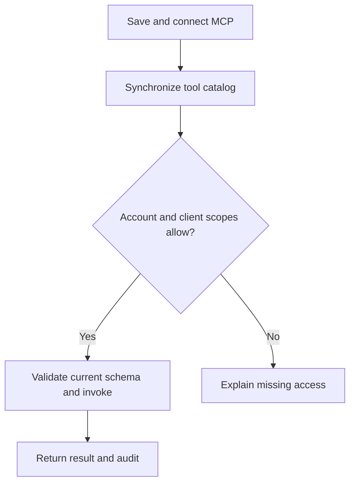

# MCP gateway and downstream servers

[简体中文](zh-CN/mcp-gateway.md) · [Documentation index](README.md)

Lingshu Gate exposes one authenticated Streamable HTTP MCP endpoint at `POST /mcp`. It aggregates reviewed first-party operations and tools discovered from configured downstream servers.

Protocol compatibility is a shared Gate platform capability. Client-to-Gate and Gate-to-server connections negotiate independently, using the same transport rules for every configured downstream service.

## Connection contract

- Endpoint: `http://127.0.0.1:8000/mcp` for the default local deployment.
- Current protocol: `2026-07-28`; incoming clients may also use the `2025-03-26`, `2025-06-18`, or `2025-11-25` handshake.
- Authentication: an authenticated Console cookie or `Authorization: Bearer <api-token>`.
- Content negotiation: follow the Streamable HTTP requirements of the protocol.
- Request model: HTTP is stateless; authenticate every request and use the framing required by its protocol version.

For `2026-07-28`, start with `server/discover`. Handshake clients start with `initialize` (`protocolVersion`, `capabilities`, and `clientInfo`), then send `notifications/initialized`. Initialization does not require a protocol-version header; an unsupported proposal negotiates `2025-11-25`. Subsequent requests use the negotiated `MCP-Protocol-Version`; without a header or current-protocol metadata, the Streamable HTTP compatibility default is `2025-03-26`. Unknown header versions are rejected. Gate does not allocate an MCP session, and supports JSON responses, `ping`, `tools/list`, and `tools/call` for handshake clients; GET/SSE and DELETE are not required or exposed.

Derive tool names from `tools/list`; do not construct them from assumptions about server IDs. Legacy clients do not need `Mcp-Method`, `Mcp-Name`, or the current protocol's per-request metadata. The existing endpoint and bearer-token configuration can be retained. Downstream protocol selection is independent and configured per manifest as described below.

Each `2026-07-28` HTTP request mirrors routing data in headers and JSON-RPC parameters:

| Location | Contract |
|---|---|
| `MCP-Protocol-Version` header | `2026-07-28` |
| `Mcp-Method` header | Exact JSON-RPC method |
| `Mcp-Name` header | Exact encoded name for a tool call or other named operation |
| `params._meta.io.modelcontextprotocol/protocolVersion` | Same protocol version as the header |
| `params._meta.io.modelcontextprotocol/clientCapabilities` | Caller capability object, even when empty |
| `params._meta.io.modelcontextprotocol/clientInfo` | Caller name and version when available |

Gate rejects a header/parameter mismatch before dispatch. A request carrying current-protocol metadata cannot fall back to legacy validation by omitting or changing its version header. This keeps routing metadata independently verifiable at the HTTP boundary.

Remote deployments must use HTTPS. Gate should remain on a private interface behind the TLS reverse proxy.

## Discovery-to-access flow



Connection synchronizes the catalog. A downstream `tools/list_changed` notification triggers refresh; a 60-second fallback covers servers without notifications. Failed refreshes retain the last complete valid catalog. Unchanged catalogs do not advance the access-policy revision.

New external tools require `write`. Names, descriptions, schemas, manifest declarations and remote annotations never grant read access. Administrators can optionally save `read`, `write`, `unknown` (disabled) or `automatic` (restore default) in Tool access. A save takes effect immediately; publication is not required. `required_access` and `policy_source` describe the enforced policy. Historical status, reviewer timestamps and safety evidence are not publication gates for ordinary invocations. Dedicated management tools cannot be downgraded through generic tool policies.

Discovery does not expand access scopes. Calls still enforce identity, functional permissions, account/role resource grants, Token/OAuth scope, expiry, service binding, argument restrictions and required credentials. Continuous service grants cover new tools at their existing level; exact selections never grow. Metadata changes preserve local access policies but require a fresh describe for a changed schema. Retirement, service replacement, disabling or policy changes do not resurrect old exact authorizations.

The existing `gate_tool_classification_list`, `gate_tool_classification_analyze`, `gate_tool_classification_review` and `gate_tool_classification_publish` IDs remain compatible. Review can save a policy in one operation. Analysis produces hints; the legacy publish operation maintains optional group-routing safety evidence and is not needed for routine connection or invocation. That evidence supports cross-instance contract comparison and routing constraints. Read-only retry uses a trusted local read policy or a Gate built-in read contract, with current authority and tool revision rechecked before dispatch. Automatic defaults are never represented as a human review.

## Downstream Streamable HTTP

Use `launch.type=external` and `transport.type=streamable_http`. Gate applies request and startup timeouts and routes discovery and calls through the registry. The same protocol selection applies to managed HTTP processes.

Omitting `transport.protocol_version`, or setting it to `auto`, enables platform-wide negotiation for HTTP and stdio. Gate first tries `2026-07-28` discovery. Only a JSON-RPC method, parameter, or protocol-version rejection during that startup probe permits one `initialize` attempt. Recognized generic server errors explicitly naming unsupported `server/discover` are also supported. Existing manifests do not need per-service edits. To select the initial protocol explicitly and disable discovery fallback, set `protocol_version` to `2026-07-28`, `2025-03-26`, `2025-06-18`, or `2025-11-25`. Initialization still accepts a different supported version returned by the server, as required by version negotiation. For example:

```json
{
  "id": "example-service",
  "launch": {"type": "external"},
  "transport": {
    "type": "streamable_http",
    "endpoint": "https://mcp.example.test/mcp",
    "protocol_version": "auto"
  },
  "auto_start": false
}
```

Gate sends `initialize`, validates the returned version and server information, then sends `notifications/initialized`. The negotiated version must be one of the three supported handshake versions. Subsequent requests use that version and any session ID assigned during initialization. JSON and POST SSE responses are supported. Sessions are scoped to their connection and credentials, never shared between per-user clients. Closing a session sends DELETE, tolerating 404/405 responses. A session-expiry 404 invalidates the connection. Gate may recover once and retry a call covered by a trusted local read policy or Gate built-in read contract once only when the contract is unchanged and current authority and argument policy still pass. Writes, grouped calls, changed contracts and failed recovery are not automatically replayed.

Timeouts, ordinary HTTP/authentication errors, invalid discovery results and business-method errors do not trigger negotiation or replay; the bounded session-expiry recovery above is separate. Automatic negotiation does not relaunch a stdio process that exits during discovery; a service requiring initialization before any other message can use an explicitly pinned version. This does not add the older HTTP+SSE transport with separate event and message endpoints, unsolicited server requests, or resumable GET streams. A naming collision anywhere in the registry fails both discovery and calls closed; visibility filtering cannot change tool identities.

There are two credential layers:

- system headers in `transport.headers`, usually expressed with `${credential:<id>}`, apply to Gate's downstream connection;
- declared `user_credentials` slots inject a value into the isolated HTTP request context only for the authenticated user making the call.

Gate does not write resolved values into manifests or return them in API responses. A missing required binding fails the call before it reaches the downstream endpoint.

## Downstream stdio

Use `launch.type=managed_process` and `transport.type=stdio` in a native deployment. Gate starts the configured executable directly, exchanges protocol messages over stdin/stdout, captures bounded diagnostic output, and tracks desired and observed state.

Stdio uses the same automatic or explicit `transport.protocol_version` selection and additionally supports `2024-11-05`, both as a configured proposal and as a negotiated result. A supported initialization protocol initializes the current process once before listing or calling tools; failed initialization stops that child. Gate does not launch a second process to probe protocol compatibility. The `2024-11-05` version is restricted to downstream stdio and does not enable the separate legacy HTTP+SSE transport or extend Gate's inbound HTTP versions.

Stdio constraints:

- the command, arguments, and working directory must be reviewed local values;
- the working directory must remain inside the configured allowed root;
- the process inherits only the configured environment and Gate service-account privileges;
- secrets use credential references and are resolved only for process launch;
- per-user secret injection is unavailable because the process is shared;
- Docker Core rejects managed local process launch.

Do not place a shell command line in one string. Keep `command` and `args` separate so the execution boundary is explicit.

## Downstream managed container

Native mode can use `launch.type=managed_container` with stdio when a local container engine is explicitly available. Gate starts only a reviewed SHA-256 digest-pinned image, then uses its stdio transport.

This is a high-trust operator feature with a fixed execution profile: no network, read-only root, no Linux capabilities, no privilege escalation, bounded memory/CPU/PIDs, and protected temporary filesystems. Bind mounts use structured `mounts`, remain read-only, and are resolved inside the allowed root again at execution. Manifest environment values cannot steer Gate or the Docker CLI. Docker Core rejects this launch type and must not receive a container-engine socket.

## Configuration lifecycle

The Console and `/v1/mcp/configs` APIs support list, validate, create, update, apply, reload, and delete operations. Runtime endpoints under `/v1/mcp/servers` expose current status, details, lifecycle actions, and discovered tools.

Recommended sequence:

1. Save credentials without exposing their values in the manifest.
2. Validate the manifest.
3. Save with `auto_start=false`.
4. Review the configuration diff and resolved credential IDs.
5. Apply or start the server.
6. Inspect health and discovered definitions.
7. Synchronize after connection; save a local policy only when a different access level is needed.
8. Add the smallest resource grants.
9. Verify one read-only call before enabling write access.

Deleting or replacing a server ID affects grants, credential bindings, runtime state, and audits. Treat it as a controlled write and back up configuration and data first.

## First-party Gate tools

Gate registers only operations that belong to its own control and delivery boundaries:

| Tool family | Purpose |
|---|---|
| `gate_system_debug` | Bounded, read-only overview, server detail, logs, events, and diagnostics |
| `gate_file_upload_*` | User-bound, short-lived file upload and `fileRef` creation for calls that explicitly accept it |
| `gate_tool_classification_*` | Tool policy lookup and one-step save; legacy analysis/publication compatibility |
| Project Delivery `gate_*` tools | Upload, build, deploy, start, status, and tool reconciliation |

The complete Delivery list is in [Project delivery](project-delivery.md). First-party tool access is subject to the same authentication, permission, scope, and audit checks as downstream tools.

## Invocation and files

REST callers can inspect definitions through `/v1/tools` and invoke an authorized tool through the documented invoke endpoint. MCP callers use `tools/list` and `tools/call`.

For tools that explicitly declare file-reference support, upload at most the bounded size through `gate_file_upload_begin`, `gate_file_upload_chunk`, and `gate_file_upload_commit`, then pass the returned short-lived `fileRef`. File references are bound to the uploading user and target context; Gate does not convert arbitrary paths from a caller into local filesystem access.

## Failure behavior

- Authentication and authorization failures do not reach downstream servers.
- Discovery failure preserves the last accepted registry snapshot where the operation supports it.
- A downstream timeout is not reported as a successful call.
- Protocol, schema, credential, and digest errors are structured and omit secret values.
- Runtime status distinguishes desired state from observed process or connection state.
- A process marked running is not sufficient evidence that tool discovery succeeded.

### Timeout outcomes in development source

An MCP waiting deadline returns structured `mcp_request_timeout` facts: transport, method, phase, connection generation, dispatch state and whether a business request was sent or remains uncertain. `retryable=false` directs callers to reconcile the original operation. A dispatched business request has `execution_state=unknown`; a timeout before business dispatch has `execution_state=not_started`. `execution_terminated=false` never claims remote cancellation. Timeout diagnostics omit raw stdout, stderr and argument values.

For eligible shared stdio business calls, `error.details.recovery_supported=true` supplies an authorized `request_handle`. Use `gate_request_status` in on-demand mode or `POST /v1/catalog/requests/status` with the original credential. Full tool list mode is unchanged and can use that REST route. `offset` defaults to 0 and `limit` to 8,192 Unicode characters, with a maximum of 65,536. Follow `next_offset` and `has_more` to assemble `response_json`. Read the original JSON-RPC `result` or `error` only after all slices are assembled. `request_state=completed` means the protocol response arrived; the envelope still has `exit_code=null` and does not infer a remote command exit.

This lookup is limited to the current Gate process and at most five minutes, subject to count and byte limits. It rechecks the complete identity, tool revision and current permissions before and after reading, without waiting on the service execution lock. HTTP, group-routed, managed business-credential and external-provider OAuth calls are outside the initial recovery scope. Queries never replay or cancel the original call, stream invented progress, create durable jobs, or guarantee recovery after a Gate restart. See [timed-out request outcomes](on-demand-tools.md#timed-out-request-outcomes) for the state contract, limits and guarded example.

Use [Operations](operations.md) to correlate server status, logs, events, diagnostics, and invocation audits without enabling payload logging.

## Optional discovery and integration

[Pins and result budgets](on-demand-tools.md) retain the same invocation checks. [Argument policies](argument-policies.md) restrict effective inputs immediately before execution. The [connector](private-connector.md) and [OpenAPI adapter](openapi-adapter.md) expose separately configured HTTP MCP endpoints that must be registered and synchronized in Core, then authorized within the account and client scope. Gate's `/docs` describes its control API; the adapter consumes a separate local upstream OpenAPI document. The [first-call demo](first-call.md) verifies read authorization, a denied write and revocation without a desktop client.
