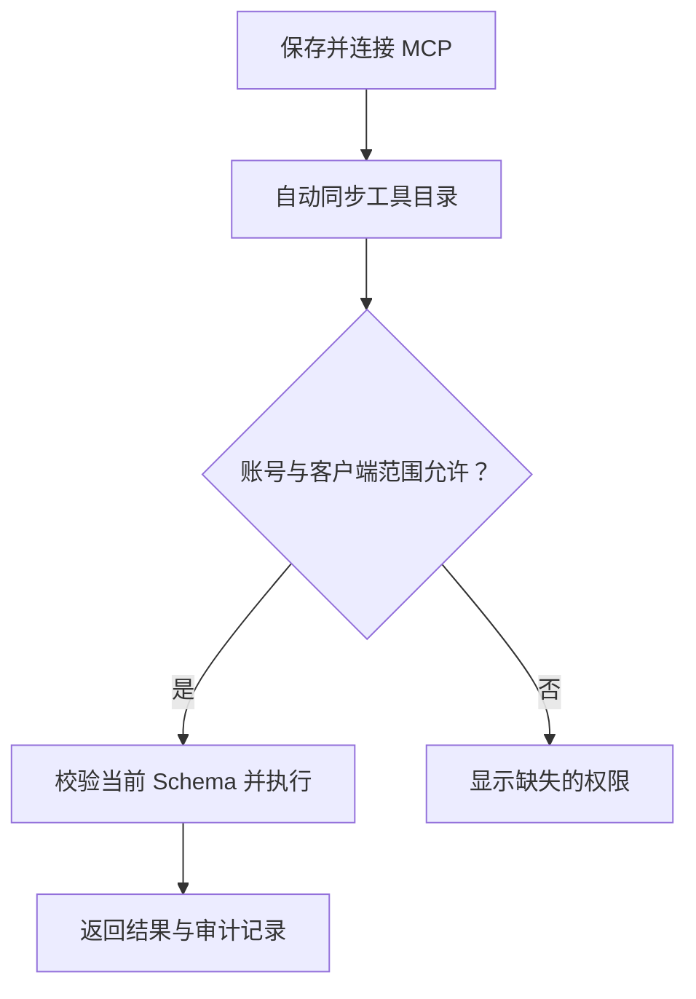

# MCP 网关与下游服务

[English](../mcp-gateway.md) · [文档索引](README.md)

Lingshu Gate 在 `POST /mcp` 提供统一的认证 Streamable HTTP MCP 入口，聚合经过复核的第一方操作和从已配置下游服务发现的工具。

协议兼容是 Gate 的通用平台能力。客户端到 Gate、Gate 到下游服务两段连接独立协商版本，所有已配置的下游服务使用统一的传输规则。

## 连接契约

- 默认本机 Endpoint：`http://127.0.0.1:8000/mcp`。
- 当前协议：`2026-07-28`；入站客户端也可使用 `2025-03-26`、`2025-06-18` 或 `2025-11-25` 握手。
- 认证：已认证的 Console Cookie，或 `Authorization: Bearer <api-token>`。
- 内容协商：遵循协议的 Streamable HTTP 要求。
- 请求模型：HTTP 无状态；每个请求都必须认证，并遵守所用协议版本的消息格式。

`2026-07-28` 客户端先调用 `server/discover`。握手客户端先调用 `initialize`（携带 `protocolVersion`、`capabilities` 和 `clientInfo`），再发送 `notifications/initialized`。初始化不要求协议版本 Header；不支持的提议版本会协商为 `2025-11-25`。后续请求使用协商后的 `MCP-Protocol-Version`；缺少 Header 且没有当前协议元数据时，按 Streamable HTTP 兼容规则默认为 `2025-03-26`。未知 Header 版本会被拒绝。Gate 不分配 MCP Session，为握手客户端提供 JSON 响应、`ping`、`tools/list` 和 `tools/call`。有权工具的变更通知流见下文；仍不提供会话 DELETE。

从 `tools/list` 获取工具名称，不要根据服务 ID 推测名称。旧版客户端不需要 `Mcp-Method`、`Mcp-Name` 或当前协议的每请求元数据，可保留既有 Endpoint 和 Bearer Token 配置。下游协议独立选择，按下文在各服务的 Manifest 中配置。

每个 `2026-07-28` HTTP 请求都在 Header 和 JSON-RPC 参数中镜像路由信息：

| 位置 | 契约 |
|---|---|
| `MCP-Protocol-Version` Header | `2026-07-28` |
| `Mcp-Method` Header | 准确的 JSON-RPC Method |
| `Mcp-Name` Header | Tool Call 或其他具名操作的准确编码名称 |
| `params._meta.io.modelcontextprotocol/protocolVersion` | 与 Header 相同的协议版本 |
| `params._meta.io.modelcontextprotocol/clientCapabilities` | 调用方 Capability Object，即使为空也必须提供 |
| `params._meta.io.modelcontextprotocol/clientInfo` | 可用时提供调用方名称和版本 |

Header 与参数不一致时，Gate 会在 Dispatch 前拒绝请求。携带当前协议元数据的请求不能通过删除或更改版本 Header 降级为旧版校验，使 HTTP 边界可以独立校验路由元数据。

远程部署必须使用 HTTPS。Gate 应保留在 TLS 反向代理之后的私有接口。

## 从发现到授权



连接时同步工具目录。下游声明 `tools.listChanged` 时，Gate 打开独立通知流，收到 `notifications/tools/list_changed` 后安排刷新；约 60 秒且带抖动的周期发现同时覆盖缺失或不支持通知的情况。密集通知由同一发现线程合并处理。刷新失败保留最近一次完整有效目录，按约 5 秒起、最长 5 分钟的指数退避自动重试。有效的空 `tools` 列表会退役工具，缺失或无效的 `result.tools` 不清空目录。目录没有变化时不更新权限策略修订。

外部新增工具默认需要 `write`，不会采信工具名称、描述、Schema、manifest 声明或 annotation 作为只读权限。管理员可以在“工具权限”按需保存 `read` / `write` / `unknown`（禁用）或 `automatic`（恢复默认），一次保存生效，无需发布。`required_access` 和 `policy_source` 表示当前有效策略；历史 `status`、复核时间和风险证据不再作为普通调用的发布门禁。受专用控制面权限管理的内置工具不能通过通用工具策略降级。

发现不授予新的访问范围。每次调用仍须同时满足身份、功能权限、账号/角色资源授权、Token/OAuth 范围、有效期、服务身份绑定、参数限制和所需凭据。服务持续授权依原级别覆盖新工具；精确工具选择不自动增加。元数据变化不删除已有本地访问策略，但变化后的 Schema 必须重新 describe；退役、服务替换、禁用或策略变更不会让旧精确授权复活。

兼容保留 `gate_tool_classification_list`、`gate_tool_classification_analyze`、`gate_tool_classification_review` 和 `gate_tool_classification_publish`。`review` 支持一次保存策略；分析只提供提示；旧发布操作仅维护可选的组路由安全证据，日常连接和调用不需要它。这些证据用于跨实例合同比较与路由约束。只读重试依据可信本地只读策略或 Gate 内置只读契约，派发前仍重新核验权限与工具版本；不能把自动默认伪装成人工复核。

本地策略保存在数据库中，普通重连和 Gate 重启后继续生效。工具从完整目录退役后，只有在同一已验证服务身份下重新出现，才恢复保守的读写默认要求；旧只读覆盖和旧精确授权不复活，明确禁用继续生效。替换后的服务保持不可用，直到管理员明确选择本地策略。缺乏充分身份或审核证据的历史记录不会提升为可信只读策略。

### 客户端工具列表更新

Gate 声明 `tools.listChanged`。`2025-*` 握手客户端可携带已协商协议版本及 `Accept: text/event-stream` 打开 `GET /mcp`；`2026-07-28` 客户端在 `POST /mcp` 调用 `subscriptions/listen`，该版本的 GET 返回 405 和 `Allow: POST`。订阅确认与后续通知绑定订阅 ID。通知流每 15 秒发送心跳，300 秒后结束，由客户端重新打开；每个 MCP 入口最多允许 64 个流，每个认证身份最多四个。

Gate 约每五秒重新检查认证、当前授权和发现模式，再比较调用者可见的工具列表。仅可见内容变化会发送 `notifications/tools/list_changed`，通知本身不包含工具名称或数量。认证凭据撤销／到期或用户停用时，下一次复核关闭流；资源规则调整则重新计算当前有权目录。按需模式的新业务工具可立即通过 search/describe 发现，无需更改固定入口；固定项或入口变化才可能改变这份列表。客户端需要监听并重新发现，或主动获取新列表，才能替换自身缓存；该机制不会扩大 OAuth 同意或精确工具范围。

### 同步状态

服务 API 的 `tool_sync` 与进程／连接健康独立，控制台展示状态、最近成功同步、新增／更新／移除数量和下次重试。`last_changed_at` 仅在目录内容变更时更新，一次无变化的成功轮询不代表新增工具。`idle`、`syncing`、`ready`、`retrying`、`auth_required`、`disabled` 描述同步状态，不代表账号权限。

HTTP 401/403 或凭据使用被拒绝时进入 `auth_required`，暂停自动重试并提示处理凭据。更新服务凭据后重新连接，或对运行中的服务点击“立即同步”。其他发现／会话故障按有界退避自动恢复。保留的目录只是最近一次接受的快照，不保证远端当前可以接受调用。

## 下游 Streamable HTTP

使用 `launch.type=external` 和 `transport.type=streamable_http`。Gate 应用请求及启动超时，并通过 Registry 路由发现和调用。受管 HTTP 进程使用相同的协议选择规则。

省略 `transport.protocol_version` 或设置为 `auto` 时，HTTP 和 stdio 均使用平台级自动协商：优先尝试 `2026-07-28` 发现，仅在启动探测收到 JSON-RPC 方法、参数或协议版本拒绝时，才尝试一次 `initialize`。明确指出不支持 `server/discover` 的已识别通用服务端错误也可进入协商。既有 Manifest 无需逐个补字段。需要指定起始协议并关闭发现回退时，可显式填写 `2026-07-28`、`2025-03-26`、`2025-06-18` 或 `2025-11-25`。初始化仍按版本协商规则接受服务端返回的其他受支持版本。例如：

```json
{
  "id": "example-service",
  "launch": {"type": "external"},
  "transport": {
    "type": "streamable_http",
    "endpoint": "https://mcp.example.test/mcp",
    "protocol_version": "auto"
  },
  "auto_start": false
}
```

Gate 发送 `initialize`，校验返回的版本及服务信息，再发送 `notifications/initialized`。协商结果必须属于上述三个握手版本。后续请求使用协商版本以及初始化时服务端分配的 Session ID，支持 JSON 和 POST SSE 响应。服务声明工具变更能力时，握手协议使用独立 GET/SSE 流，`2026-07-28` 使用 `subscriptions/listen`；不支持 GET、方法被拒绝或工具变更订阅未获接受时，回到周期发现。会话限定在当前连接与凭据内，不在不同用户的客户端之间共享。关闭会话时发送 DELETE，允许下游返回 404/405。会话过期返回 404 时连接失效，并安排重新握手和发现；仅由可信本地只读策略或 Gate 内置只读契约覆盖、合同未变且当前权限和参数策略仍通过的调用可重试一次。写调用、分组调用、变化合同或恢复失败不会自动重放。

超时、普通 HTTP/认证错误、无效发现结果及业务方法错误不触发协商或重放；前述有界会话恢复另行处理。自动协商不会重新启动在发现阶段退出的 stdio 进程；要求首条消息必须为初始化的服务，可显式固定版本。本次不增加使用独立事件与消息端点的旧 HTTP+SSE 传输、服务端主动请求或可恢复的 GET 事件流。Registry 中任意命名冲突都会让发现与调用一致地拒绝处理，可见性过滤不改变工具标识。

凭据分为两层：

- `transport.headers` 中的系统 Header 通常使用 `${credential:<id>}`，应用于 Gate 的下游连接；
- Manifest 声明的 `user_credentials` Slot，只把值注入实际发起调用的认证用户独立 HTTP 请求上下文。

Gate 不会把解析后的值写入 Manifest 或 API 响应。缺少必填绑定时，请求会在到达下游 Endpoint 前失败。

## 下游 stdio

原生部署使用 `launch.type=managed_process` 和 `transport.type=stdio`。Gate 直接启动配置的可执行文件，通过 stdin/stdout 交换协议消息，捕获受限诊断输出，并跟踪期望状态和观测状态。

Stdio 使用相同的自动或显式 `transport.protocol_version` 选择规则，并额外支持 `2024-11-05`，可作为配置中的提议版本或实际协商结果。协商使用受支持的初始化协议后，在发现和调用工具前对当前进程初始化一次；初始化失败会停止该子进程，不额外启动进程探测兼容性。`2024-11-05` 仅用于下游 stdio，不增加独立的旧 HTTP+SSE 传输，也不扩大 Gate 入站 HTTP 的版本范围。

Stdio 约束：

- 命令、参数和工作目录必须是经过复核的本机值；
- 工作目录必须位于配置的 Allowed Root 内；
- 进程只继承配置的环境和 Gate 服务账户权限；
- Secret 使用凭据引用，只在进程启动时解析；
- 进程由用户共享，因此不能注入按用户隔离的 Secret；
- Docker Core 会拒绝受管本机进程启动。

不要把 Shell 命令行写成一个字符串。保持 `command` 和 `args` 分离，让执行边界清晰可见。

## 下游受管容器

本机容器引擎显式可用时，原生模式可以组合 `launch.type=managed_container` 与 stdio。Gate 只会启动经过复核且固定 SHA-256 Digest 的镜像，再使用其 stdio 传输。

这是使用固定执行配置的高信任管理员能力：无网络、只读根文件系统、无 Linux Capability、禁止权限提升、限制内存/CPU/PIDs，并使用受保护的临时文件系统。Bind Mount 必须使用结构化 `mounts`，保持只读，并在执行时再次确认位于 Allowed Root 内。Manifest Environment 不能控制 Gate 或 Docker CLI。Docker Core 会拒绝该 Launch Type，也不得获得容器引擎 Socket。

## 配置生命周期

Console 和 `/v1/mcp/configs` API 支持列表、校验、创建、更新、应用、重新加载和删除。`/v1/mcp/servers` 下的运行时 Endpoint 提供当前状态、详情、生命周期操作和发现的工具。

建议顺序：

1. 保存凭据，不在 Manifest 暴露值。
2. 校验 Manifest。
3. 以 `auto_start=false` 保存。
4. 复核配置 Diff 和解析到的凭据 ID。
5. 应用或启动服务。
6. 检查健康状态和发现的定义。
7. 连接后自动同步目录；需要调整权限级别时保存本地策略。
8. 添加最小资源授权。
9. 先验证一次只读调用，再开放写权限。

删除或替换服务 ID 会影响授权、凭据绑定、运行状态和审计。应将其作为受控写操作，并先备份配置和数据。

## Gate 第一方工具

Gate 只注册属于自身控制和交付边界的操作：

| 工具族 | 用途 |
|---|---|
| `gate_system_debug` | 受限只读的概览、服务详情、日志、事件和诊断 |
| `gate_file_upload_*` | 为明确接受文件引用的调用创建用户绑定、短期有效的 `fileRef` |
| `gate_tool_classification_*` | 工具策略查询与一次保存；旧分析/发布操作保留兼容 |
| 项目交付 `gate_*` 工具 | 上传、构建、部署、启动、状态和工具对账 |

完整交付工具列表见 [项目交付](project-delivery.md)。第一方工具与下游工具遵循相同的认证、权限、scope 和审计检查。

## 调用和文件

REST 调用方可以通过 `/v1/tools` 检查定义，并通过文档中的 Invoke Endpoint 调用已授权工具。MCP 调用方使用 `tools/list` 和 `tools/call`。

对于明确声明支持文件引用的工具，依次调用 `gate_file_upload_begin`、`gate_file_upload_chunk` 和 `gate_file_upload_commit` 完成受限大小上传，再传递返回的短期 `fileRef`。文件引用绑定上传用户和目标上下文；Gate 不会把调用方提供的任意路径转换为本机文件系统访问。

## 失败行为

- 认证和授权失败不会到达下游服务。
- 在操作支持的情况下，发现失败会保留上一次已接受的 Registry 快照。
- 下游超时不会被报告为成功调用。
- 协议、Schema、凭据和摘要错误使用结构化响应，且不含 Secret 值。
- 运行状态会区分期望状态与观测到的进程或连接状态。
- 进程标记为 Running 不能证明工具发现已经成功。

### 开发源码中的超时结果查询

MCP 等待期限到期时返回结构化 `mcp_request_timeout`，标明传输、方法、阶段、连接代际、派发状态，以及业务请求是否已发出或仍不能确认。`retryable=false` 提示先核对原操作。业务请求已派发时为 `execution_state=unknown`，业务派发前超时为 `execution_state=not_started`；`execution_terminated=false` 不表示远端已取消。超时诊断不包含原始 stdout、stderr 或参数值。

符合条件的共享 stdio 业务调用会通过 `error.details.recovery_supported=true` 提供有权查询的 `request_handle`。使用原凭据在按需模式调用 `gate_request_status`，或调用 `POST /v1/catalog/requests/status`。完整工具列表模式保持不变，可使用该 REST 接口。`offset` 默认 0，`limit` 默认 8,192 个 Unicode 字符，上限为 65,536；按 `next_offset` 和 `has_more` 拼接 `response_json`，拼接完整后再检查原 JSON-RPC `result` 或 `error`。`request_state=completed` 仅表示协议响应已到达，查询封装仍为 `exit_code=null`，不会推断远端命令退出。

查询仅限当前 Gate 进程，期限最多五分钟，并受条数及字节上限约束。读取前后复核完整身份、工具版本及当前权限，不等待服务执行锁。第一批恢复范围不包含 HTTP、分组路由、托管业务凭据或外部提供方 OAuth 调用。查询不会重放或取消原调用、生成虚构进度、创建持久任务，也不保证 Gate 重启后恢复。状态合同、容量限制和带条件的调用示例见[超时请求结果查询](on-demand-tools.md#超时请求结果查询)。

使用 [运维](operations.md) 关联服务状态、日志、事件、诊断和调用审计，不需要开启 Payload 日志。

## 可选发现与集成

[固定项和结果预算](on-demand-tools.md)保留相同调用检查，[参数策略](argument-policies.md)在执行前限制实际输入。[连接器](private-connector.md)和[OpenAPI 适配器](openapi-adapter.md)提供单独配置的 HTTP MCP 地址，仍须在 Core 注册并同步，再按账号与客户端范围授权。Gate 的 `/docs` 描述控制 API；适配器消费另一个本地上游 OpenAPI 文件。[首次调用演示](first-call.md)无需桌面客户端即可验证只读授权、写入拒绝和撤销。
